<p align="center">
  
</p>

<p align="center"><strong>Mini apps para que los niños aprendan jugando, hechas para el celular y la tablet.</strong></p>

<p align="center">
  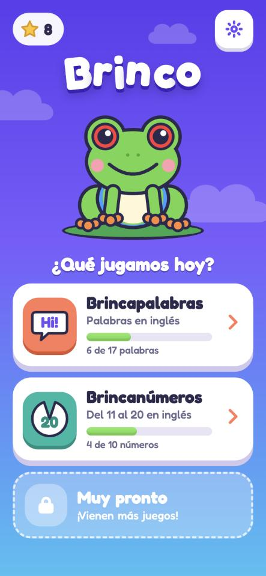
  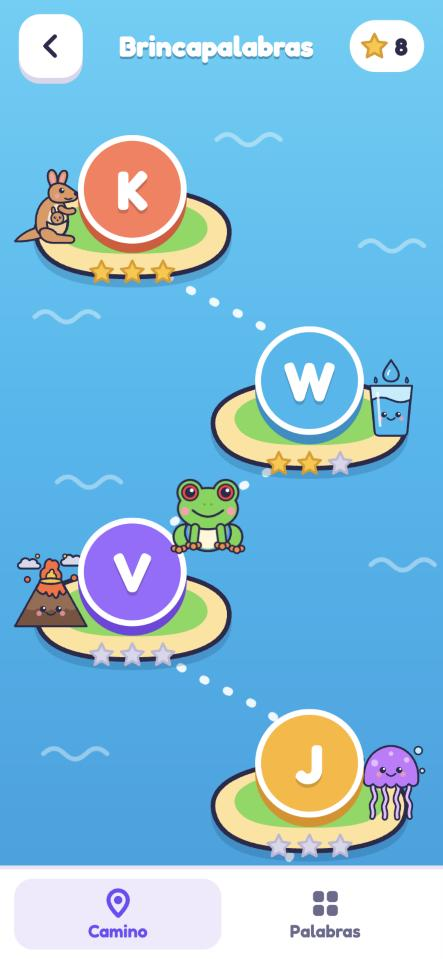
  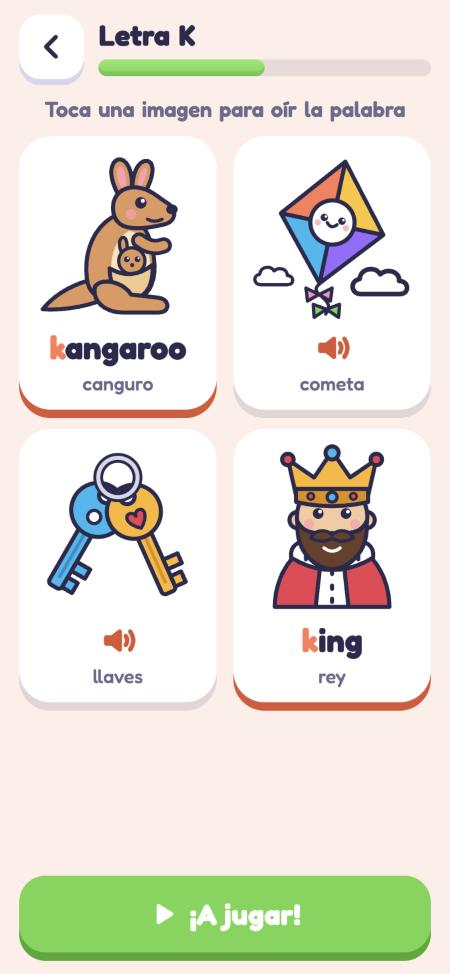
  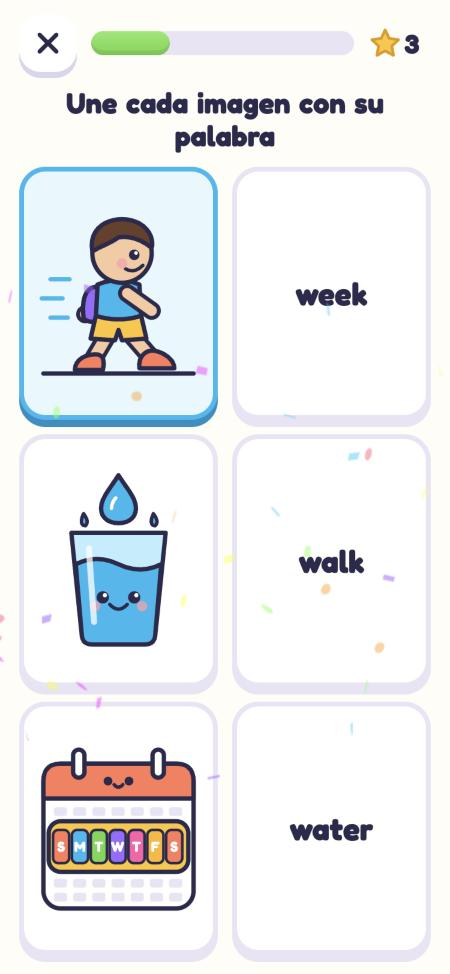
</p>

## Brincapalabras, la primera app

Practica 17 palabras en inglés, agrupadas por su letra inicial. Al tocar una imagen, el navegador dice la palabra en inglés. Si se toca otra vez, la repite más lento.

| Letra | Palabras |
|---|---|
| **K** | kangaroo (canguro), kite (cometa), keys (llaves), king (rey) |
| **W** | water (agua), walk (caminar), week (semana) |
| **V** | van (buseta), vest (chaleco), violin (violín), vase (florero), volcano (volcán) |
| **J** | juice (jugo), jam (mermelada), jumper (suéter), jump (brincar), jellyfish (medusa) |

Cada lección mezcla cuatro ejercicios: escuchar y tocar, leer y tocar, unir parejas y armar la palabra. No hay vidas ni castigos: un error recibe una respuesta amable y el ejercicio vuelve al final.

## Brincanúmeros

Practica los números del 11 al 20 en inglés. Cada número se presenta como **diez y algunos más**, con marcos de diez.

<p align="center">
  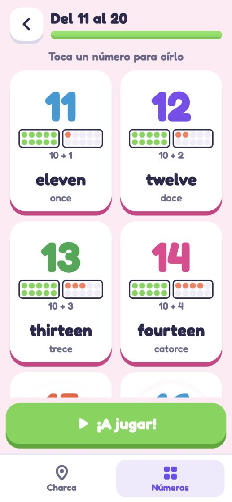
  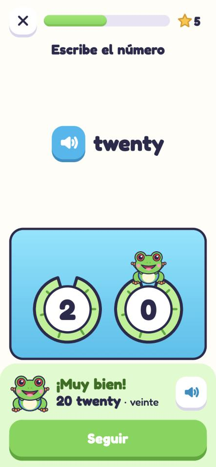
  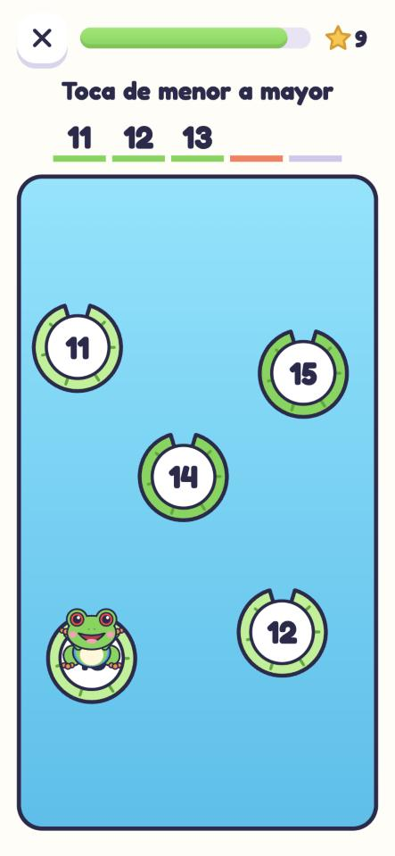
  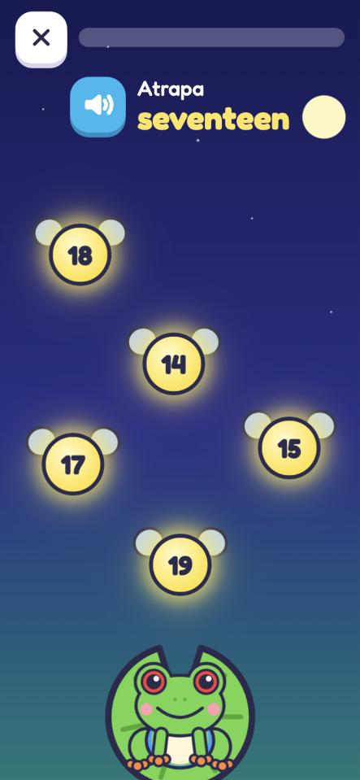
</p>

- **Escucha y toca** y **Lee y toca:** oír o leer el número y encontrarlo.
- **Cuenta:** contar desde diez tocando el marco.
- **Escribe el número:** oírlo y tocar sus cifras, mientras la rana salta a cada hoja.
- **Brinca en orden** y **¿Qué número falta?:** la rana salta por las hojas de nenúfar.
- **Une las parejas:** cada número con su palabra.
- **Atrapa las luciérnagas:** un minijuego en el que la rana atrapa con la lengua el número que oye.

## Brincaescuela

Practica seis lugares de la escuela en inglés: garden (jardín), restroom (baño), principal's office (dirección), library (biblioteca), classroom (aula) y cafeteria (comedor).

<p align="center">
  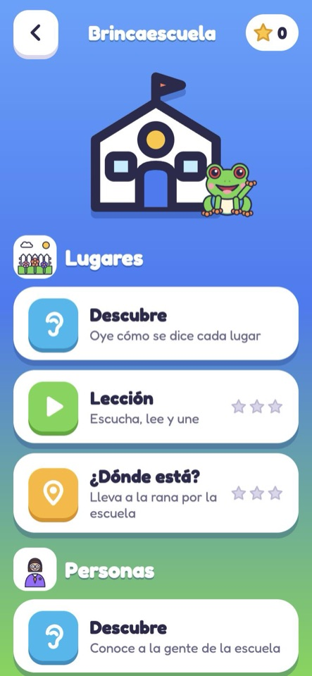
  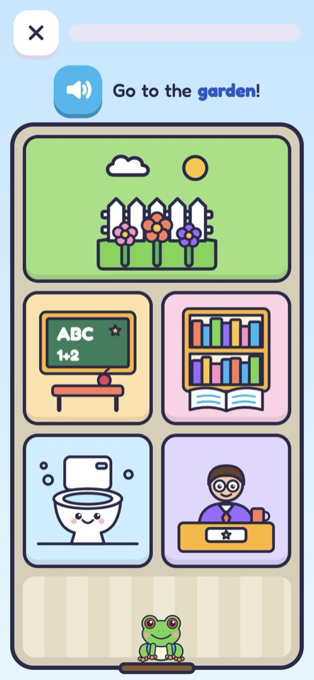
</p>

- **Descubre:** tocar cada lugar para oír su nombre.
- **Lección:** escuchar y tocar, leer y tocar, y unir parejas.
- **¿Dónde está?:** la voz dice, por ejemplo, "Go to the library!" y la rana salta al lugar que el niño toca en el plano de la escuela.

## Brincamigos

Practica en inglés siete personas de la escuela: principal (directora), cook (cocinero), janitor (conserje), students (estudiantes), teacher (maestra), security guard (guarda) y secretary (secretario).

<p align="center">
  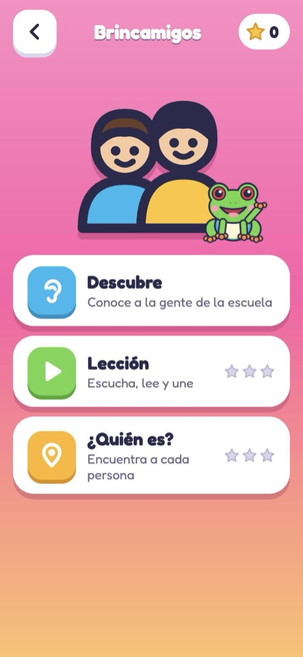
  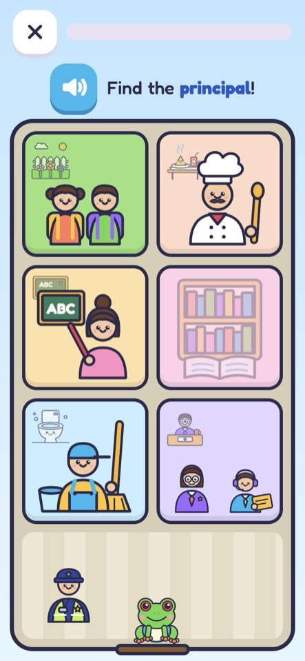
</p>

- **Descubre:** tocar a cada persona para oír quién es.
- **Lección:** escuchar y tocar, leer y tocar, y unir parejas.
- **¿Quién es?:** cada persona está en su lugar del plano, como el cocinero en el comedor. La voz dice "Find the cook!" y el niño la toca.

Brincaescuela y Brincamigos comparten las pantallas de `src/apps/escuela/`; cada uno pasa su propio tema (`topics.ts` y `amigos/topic.ts`).

## Brincadónde

Practica tres posiciones en inglés con la rana: **next to** (al lado de), **in front of** (delante de) y **between** (entre). Los objetos de referencia son dibujos de Brincapalabras, así que las frases también repasan vocabulario: *"The frog is between the van and the vase."*

<p align="center">
  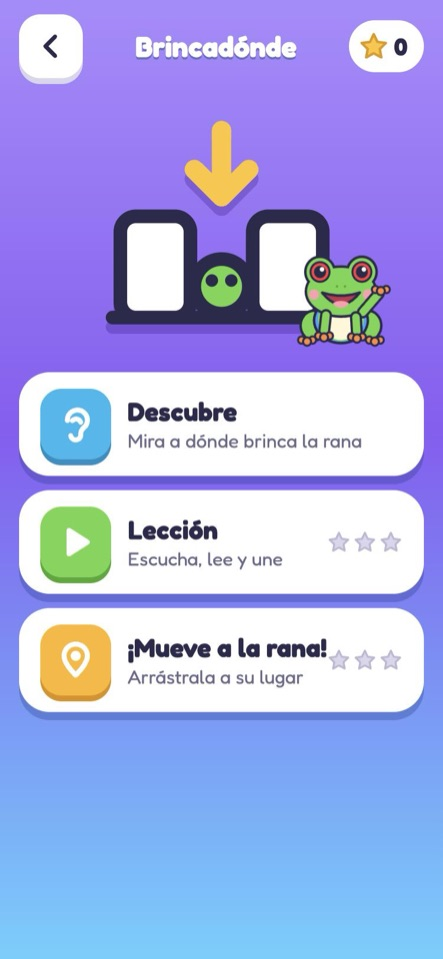
  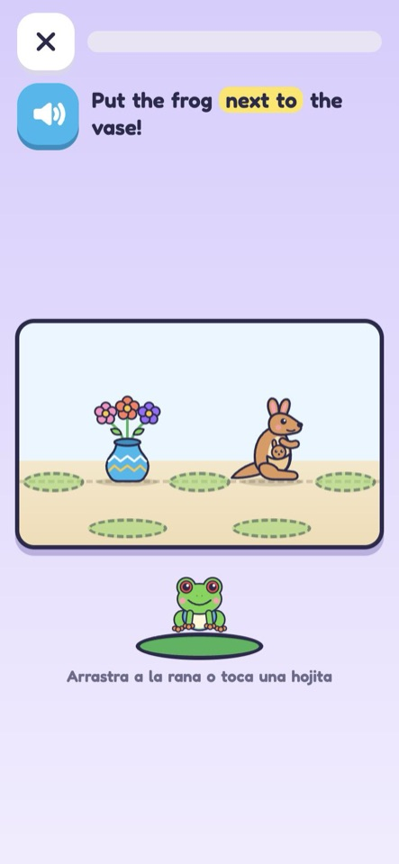
</p>

- **Descubre:** al tocar cada tarjeta, la rana brinca a esa posición y la voz dice la frase.
- **Lección:** escuchar o leer la frase y elegir la escena correcta, y unir cada escena con su frase.
- **¡Mueve a la rana!:** la voz dice, por ejemplo, "Put the frog in front of the vase!" y el niño arrastra a la rana o toca la hojita donde va.

## En tablets

Brinco funciona en iPad y en tablets Android, en vertical y en horizontal. Los teléfonos siguen solo en vertical.

<p align="center">
  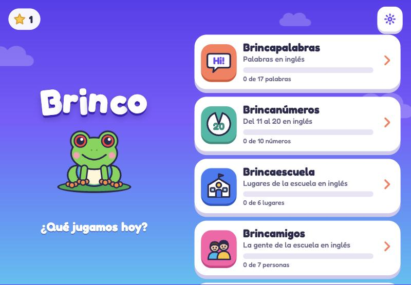
  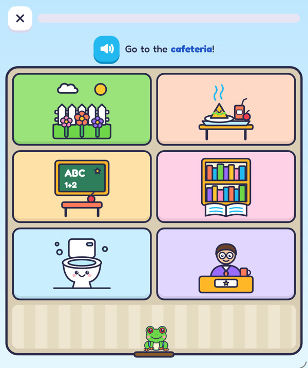
</p>

- En una tablet, `fitTabletViewport()` (`src/shared/lockViewport.ts`) agranda toda la página con la etiqueta viewport y marca `<html class="tablet">`. La escala sale del lado corto de la pantalla, así que al girarla todo conserva su tamaño. Con la ventana partida en un iPad se usa el diseño de teléfono.
- No se usa CSS `zoom`, para que el arrastre y las medidas de los juegos sigan funcionando.
- En horizontal, cada pantalla reparte su contenido con reglas `.tablet` dentro de `@media (orientation: landscape)`:
  - el inicio pone la rana a un lado y las apps al otro;
  - Descubre muestra 4 tarjetas por fila;
  - el plano de la escuela usa 3 columnas;
  - en "¡Mueve a la rana!", el escenario queda junto a la hojita de salida.
- Los juegos que miden posiciones vuelven a medir con `ResizeObserver` cuando la tablet gira.

## Instalarla en el teléfono o la tablet

La página **Instala Brinco** (`#/instalar`) explica en español, paso a paso, cómo instalarla en iPhone o iPad (Safari) y en Android (Chrome). Abre sola la pestaña del teléfono que se usa y, en Android, ofrece un botón para instalar directo cuando el navegador lo permite. Se llega desde una tarjeta del inicio, que desaparece una vez instalada, y desde **Ajustes**.

<p align="center">
  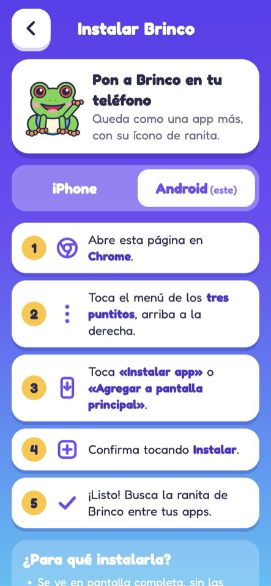
</p>

## Publicarla en un servidor

Es un sitio estático, así que no necesita base de datos ni configuración.

1. Descarga `brinco-web.zip` desde [la última versión](https://github.com/fufales/brinco/releases/latest).
2. Descomprímelo y sube su contenido a cualquier carpeta de tu servidor.
3. Abre esa dirección en el celular.

Con HTTPS, además se puede instalar en la pantalla de inicio y usar sin conexión.

## Lanzar una versión

Desde `main`, sin cambios pendientes:

```bash
npm version patch
```

Usa `patch` para arreglos, `minor` para funciones nuevas y `major` para cambios grandes. El comando corre las pruebas, sube la versión, crea el commit y el tag, y hace push. Con ese tag, CI crea el Release que el servidor despliega. Un push normal a `main` no llega a los teléfonos.

Cada Release trae `brinco-web.zip` y `brinco-web.zip.sha256`. Antes de descomprimir en el servidor, conviene verificar el paquete:

```bash
sha256sum -c brinco-web.zip.sha256
```

La app instalada busca versiones nuevas al abrirse, al volver a primer plano y cada 15 minutos. La descarga en segundo plano y se actualiza sola en cuanto el niño sale de una actividad, sin perder el progreso. La versión actual se ve en **Ajustes**, donde también se puede buscar una actualización a mano.

Si hay un CDN delante del servidor, no debe cachear `sw.js` ni `index.html`: retrasaría las actualizaciones.

## Sobre la voz

Cada palabra y frase en inglés suena con una voz realista grabada de antemano (`public/voice/`), igual en todos los teléfonos y sin internet una vez instalada. Si alguna frase no tuviera audio, la app usa la voz del propio dispositivo como respaldo. Los papás pueden cambiar la velocidad en **Ajustes**, con el engrane de la pantalla de inicio.

### Generar las voces (solo en desarrollo)

Los audios se generan con [OpenRouter](https://openrouter.ai) (`elevenlabs/eleven-v4`, voz `sarah`) y se guardan en el repositorio, así que la app nunca llama a un modelo.

1. Pon tu clave en `.env.local`, que git ignora:

   ```bash
   echo "OPENROUTER_API_KEY=tu-clave" > .env.local
   ```

2. Agrega las frases nuevas en [`src/shared/voice/phrases.ts`](src/shared/voice/phrases.ts) y genera solo las que faltan:

   ```bash
   npm run voices
   ```

`npm test` falla si alguna frase se queda sin audio o si una clave aparece en el repositorio.

## Desarrollo

Necesitas Node 22 o más reciente.

```bash
npm install
```

```bash
npm run dev
```

```bash
npm test
```

```bash
npm run build
```

El resultado queda en `dist/`.

### Agregar otra app

1. Crea su carpeta en `src/apps/`.
2. Añade una entrada en [`src/apps/registry.ts`](src/apps/registry.ts). Ya aparece sola en el inicio, con su propia ruta.
3. En las pantallas que no se deben interrumpir, llama a `useBlockUpdates()`: las actualizaciones esperarán a que se cierren.
4. Registra sus frases en inglés en `src/shared/voice/phrases.ts` y corre `npm run voices`.

El código común está en `src/shared/`: voz, sonidos, progreso, botones y la mascota. En `src/shared/lesson/` está lo necesario para armar lecciones: `LessonRunner`, `DiscoverGrid`, `MatchBoard` y la pantalla de resultados.

## Privacidad

No hay cuentas, analíticas ni llamadas a servicios externos: las voces vienen dentro de la app. El progreso se guarda solo en el dispositivo.

## Licencia

Código e ilustraciones bajo [licencia MIT](LICENSE). La fuente [Fredoka](https://fonts.google.com/specimen/Fredoka) usa la licencia SIL Open Font.
